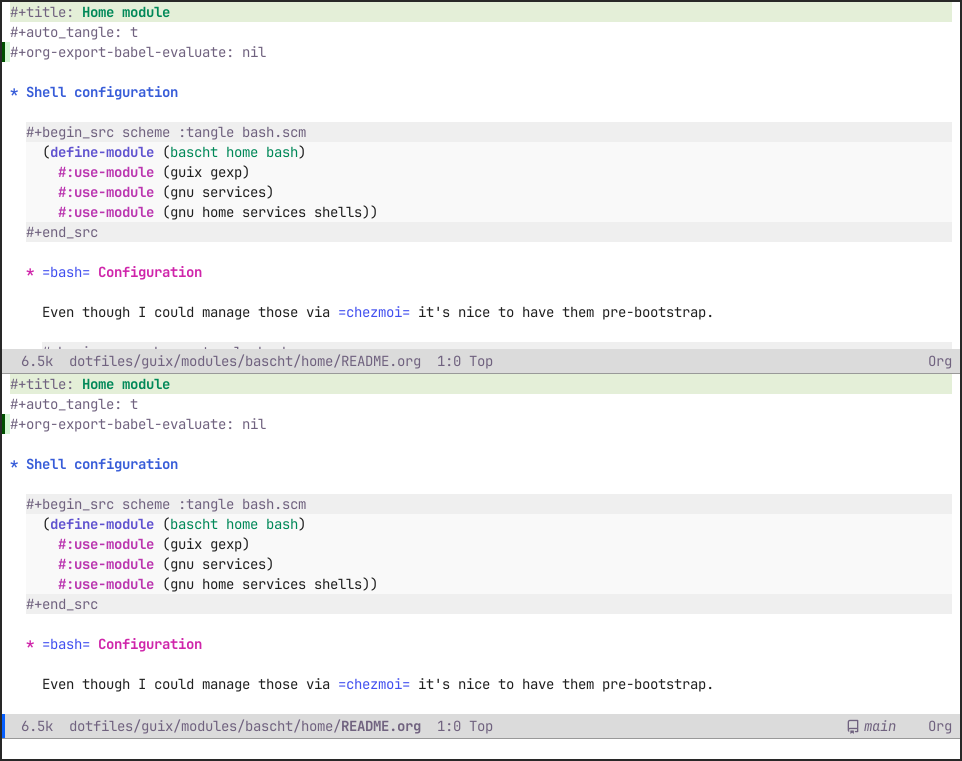
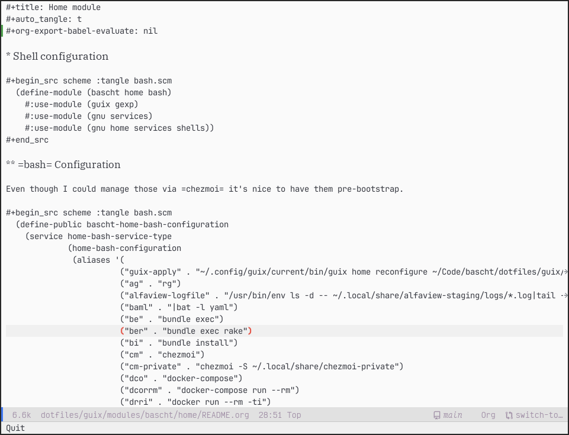
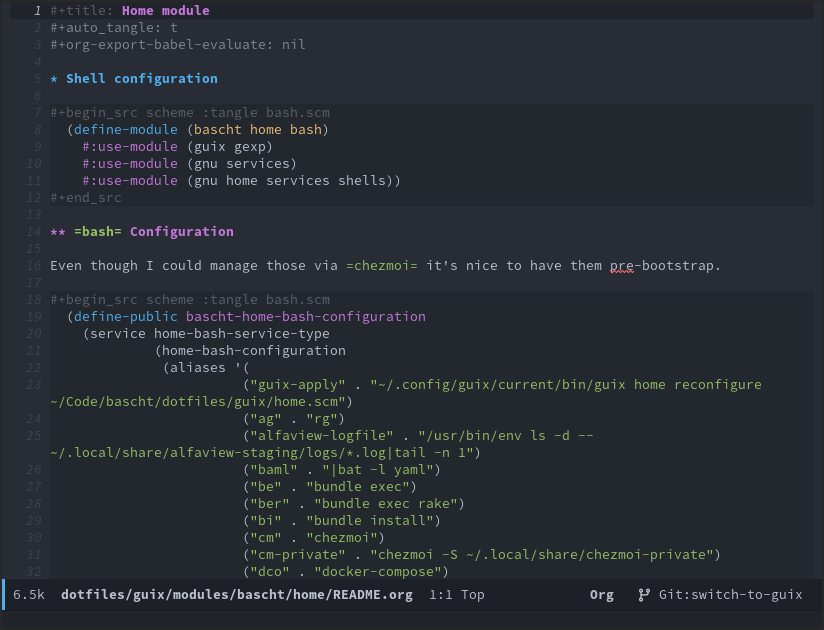

#+title: Home module
#+auto_tangle: t
#+org-export-babel-evaluate: nil

* Shell configuration

#+begin_src scheme :tangle bash.scm
  (define-module (bascht home bash)
    #:use-module (guix gexp)
    #:use-module (gnu services)
    #:use-module (gnu home services shells))
#+end_src

** =bash= Configuration

Even though I could manage those via =chezmoi= it's nice to have them pre-bootstrap.

#+begin_src scheme :tangle bash.scm
  (define-public bascht-home-bash-configuration
    (service home-bash-service-type
             (home-bash-configuration
              (aliases '(
                        ("guix-apply" . "~/.config/guix/current/bin/guix home reconfigure ~/Code/bascht/dotfiles/guix/home.scm")
                        ("ag" . "rg")
                        ("alfaview-logfile" . "/usr/bin/env ls -d -- ~/.local/share/alfaview-staging/logs/*.log|tail -n 1")
                        ("baml" . "|bat -l yaml")
                        ("be" . "bundle exec")
                        ("ber" . "bundle exec rake")
                        ("bi" . "bundle install")
                        ("cm" . "chezmoi")
                        ("cm-private" . "chezmoi -S ~/.local/share/chezmoi-private")
                        ("dco" . "docker-compose")
                        ("dcorrm" . "docker-compose run --rm")
                        ("drri" . "docker run --rm -ti")
                        ("dry" . "drri -v /var/run/docker.sock:/var/run/docker.sock skanehira/docui")
                        ("emacseval" . "emacs -batch -l ~/.emacs.d/init.el -eval '\\''(org-batch-agenda a)'\\''")
                        ("g" . "git")
                        ;; ("gcm" . ,(literal-string "git checkout $(git branch --format='%(refname:short)' | grep -E '^main|^master')"))
                        ("gf" . "git fetch -a && git rebase && git --no-pager today-all;  commandline --insert '\\'''\\''")
                        ("git-cleanup-merged-branches" . "git fetch -va && git branch --merged | egrep -v '\\''(^\\*|master)'\\'' | xargs git branch -d")
                        ("gp" . "gopass")
                        ("hl" . "hledger")
                        ("k" . "kubectl")
                        ("kgp" . "kubectl get pods")
                        ("kn" . "kubens")
                        ("krs" . "kubectl rollout status")
                        ("ls" . "eza --icons")
                        ("nps" . "nix search nixpkgs ")
                        ("osslb64" . "base64 -d | openssl x509 -noout -text")
                        ("osslc" . "openssl s_client -connect")
                        ("osslx" . "openssl x509 -noout -text")
                        ("oyaml" . "-o yaml")
                        ("scp-yop" . "scp -q -o UserKnownHostsFile=/dev/null -o StrictHostKeyChecking=no")
                        ("ssh-yop" . "ssh -o UserKnownHostsFile=/dev/null -o StrictHostKeyChecking=no")
                        ("tdir" . "take $(mktemp -d --suffix=.$(basename $(pwd)))")
                        ("termbin" . "nc termbin.com 9999")
                        ("va" . "vagrant")
                        ("vim" . "em")
                        ("wlposslx" . "wl-paste|openssl x509 -noout -text")
                        ("wttr" . "curl '\\''wttr.in/Neuwied?1pQF&lang=de'\\''")))

              (bashrc (list (local-file ".bashrc" "bashrc")))
              (bash-logout (list (local-file ".bash_logout" "bash_logout"))))))
#+end_src

** Bash config files

*** Bash rc

#+begin_src scheme :tangle .bashrc
# ~/.bashrc: executed by bash(1) for non-login shells.
# see /usr/share/doc/bash/examples/startup-files (in the package bash-doc)
# for examples

# If not running interactively, don't do anything
case $- in
    *i*) ;;
      *) return;;
esac

HISTCONTROL=ignoredups:ignorespace
HISTFILESIZE=80000
HISTSIZE=10000
GPG_TTY="$(tty)"
export GPG_TTY

shopt -s histappend
shopt -s checkwinsize
shopt -s extglob
shopt -s globstar
shopt -s checkjobs

~/.guix-home/profile/bin/gpg-connect-agent updatestartuptty /bye > /dev/null

eval "$(~/.guix-home/profile/bin/zoxide init bash )"

if [[ $TERM != "dumb" ]]; then
  eval "$(~/.guix-home/profile/bin/starship init bash --print-full-init)"
fi

if [[ :$SHELLOPTS: =~ :(vi|emacs): ]]; then
  # source ~/.guix-home/profile/share/blesh/ble.sh # This sucks
  eval "$(~/.guix-home/profile/bin/atuin init bash '--disable-up-arrow')"
fi

for f in ~/.config/bash/*.sh; do source $f; done
source "${HOME}/.guix-home/profile/etc/bash-completion.d/"*
source "${HOME}/.guix-home/profile/etc/bash_completion.d/"*

eval "$(direnv hook bash)"
#+end_src

*** Bash logout

#+begin_src scheme :tangle .bash_logout
# ~/.bash_logout: executed by bash(1) when login shell exits.
# when leaving the console clear the screen to increase privacy
if [ "$SHLVL" = 1 ]; then
    [ -x /usr/bin/clear_console ] && /usr/bin/clear_console -q
fi
#+end_src

* Emacs Services

I like having multiple Emacs servers running in the background each with specific modules loaded depending on their workload: They're called:

** =Emacs=

This is the _general purpose_ Emacs, even though it's heavily tailored towards the Desktop workloads like Email, OrgMode, rss and … you know, the occasional file edit.

#+begin_src sh :results output :session test :async yes :eval never-export
  # swaymsg exec -- emacsclient -s workmacs --create-frame "$(pwd)/README.org"
  grimshot save window "$(pwd)/screenshot-emacs.png"
#+end_src

#+RESULTS:
: /var/home/bascht/Code/bascht/dotfiles/guix/modules/bascht/home/screenshot-emacs.png

#+CAPTION: Screenshot of my current default emacs configuration

** =Comacs=

Comacs is the Workhorse. It's where I open work- and private code projects with. It has all the major and minor modes I need for my day-to-day work. It doesn't do Email or even Org Agendas. And it keeps all the language servers at bay. This might become less of an issue in the future, but some of those background NodeJS language servers tend to get leaky after a few days of uptime.

#+begin_src sh :results output :session test :async yes :eval never-export
  # swaymsg exec -- emacsclient -s comacs --create-frame "$(pwd)/README.org"
  grimshot save window "$(pwd)/screenshot-comacs.png"
#+end_src

#+CAPTION: Screenshot of my current comacs configuration

** =Workmacs=

Workmacs is the final evolution form of my old =worklogger= script. It started out as a simple Loop, evolved into a [[https://github.com/bascht/worklogger][Python module]] and later into a Zenity bash loop. As all things finally evolve into Emacs, I now keep a separate server with a distinct theme and font style (this might be the only serif font in my UI). I also keep this window open in the Sway scratchpad so it will open in an instant.

This might sound weird but even a 500ms startup time will distract me from what I even wanted to note down, or it annoys me and I will close the window again.

#+begin_src sh :results output :session test :async yes :eval never-export
  # swaymsg exec -- emacsclient -s workmacs --create-frame "$(pwd)/README.org"
  grimshot save window "$(pwd)/screenshot-workmacs.png"
#+end_src

#+RESULTS:
: /var/home/bascht/Code/bascht/dotfiles/guix/modules/bascht/home/screenshot-workmacs.png

#+CAPTION: Screenshot of my current comacs configuration

